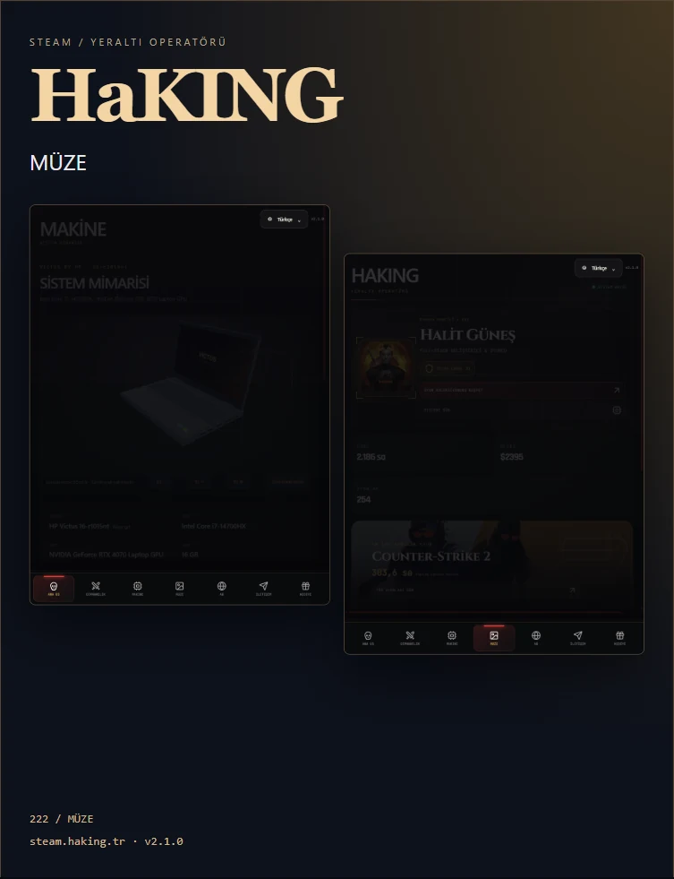

# HaKING

<p align="center"></p>

<p align="center"><strong>Halit Güneş · Oyun profili, görsel arşiv ve kişisel sistem vitrini</strong></p>
<p align="center"><a href="https://steam.haking.tr/">Web sitesi</a> · <a href="CHANGELOG.md">Sürüm notları</a> · <a href="CONTRIBUTING.md">Katkıda bulunma</a> · <a href="LICENSE">MIT lisansı</a></p>

  

## Deneyim

HaKING; Steam oyun koleksiyonunu, oyunlardan kaydedilen anları ve kişisel donanım vitrininin aynı arayüzde buluştuğu statik bir web projesidir. Derleme veya npm kurulumu gerektirmez. Koyu arayüz, erişilebilir dil menüsü ve mobil gezinme kullanır.

| Alan | Özellikler |
| --- | --- |
| Koleksiyon | Oyun arama, sıralama, oynama süreleri ve güncellenen Steam verileri |
| Müze | Altı seçili favori, tüm açık görseller, oyun filtresi, kademeli yükleme |
| Görsel inceleyici | Asıl Steam dosyası, ok tuşları, Escape, kaynak sayfasına bağlantı |
| Makine | HP Victus 16-r1015nt, Koyu gri; etkileşimli 3D, klavye, alt ızgara, fan temsili ve kamera açıları |
| Dil | 20 dil; kendi adlarıyla aranabilir, kaydırılabilir menü; Arapça RTL |
| Destek | Steam takası veya [Buy Me a Coffee](https://buymeacoffee.com/haking) |
| İletişim | steam@haking.tr adresine önceden doldurulmuş e-posta taslağı |
| Hareket | Kaydırma ilerlemesi, donanım anlatımı ve azaltılmış hareket tercihi |

### Donanım

Intel Core i7-14700HX · NVIDIA GeForce RTX 4070 Laptop GPU · 16 GB RAM · 1 TB SSD · 144 Hz Full HD (1920 × 1080).

Ürün kodu ve renk sahibi tarafından doğrulanmıştır. 3D model elle hazırlanmış web görselleştirmesidir; üreticinin CAD dosyası veya ölçü doğrulanmış dijital ikizi değildir. Fanlar ve iç detaylar açıklayıcı temsildir; gerçek zamanlı sıcaklık ya da RPM ölçülmez. [HP ürün desteği](https://support.hp.com/tr-tr/drivers/victus-by-hp-16.1-inch-gaming-laptop-pc-16-r1000/model/2101982951?sku=9J217EA).

## Yerel kurulum

Python 3.12 veya daha yenisi önerilir. Ana çalışma ve push klasörü: `C:\Users\halit\OneDrive\Belgeler\GitHub\HaKING`.

```powershell
python -m http.server 8000
```

`http://localhost:8000` adresini açın. `file://` kullanmayın: veri dosyaları HTTP üzerinden yüklenir. Siteyi görüntülemek için ek bağımlılık kurulumu gerekmez. Bakım scriptleri için:

```powershell
python -m pip install -r requirements.txt
python scripts/sync_screenshots.py
python scripts/resolve_media.py
```

## Mimari

```text
index.html                 Sayfa yapısı ve erişilebilir içerik
assets/css/                Temel arayüz ve deneyim stilleri
assets/js/main.js          Gezinme, Steam koleksiyonu, iletişim
assets/js/upgrade.js       Dil menüsü ve görsel inceleyici
assets/js/victus.js        Yerel Three.js görselleştirmesi
assets/js/translations.js  20 dilin sözlükleri
assets/vendor/             Three.js ve lisansı
assets/posters/            40 WebP tanıtım görseli
data/                      Steam verisi, ekran görüntüleri, favoriler
posters/                   Dil bazlı tanıtım sayfaları
docs/                      Gerçek site ekran görüntüleri
scripts/                   Arşiv ve tanıtım sayfası üretimi
.github/                   Otomasyonlar, issue ve PR şablonları
```

## Veri güncelleme

`Update Steam Stats` iş akışı oyun verisini 30 dakikada bir yeniler. Repository secrets altında `STEAM_API_KEY` gerekir. Steam oyun ayrıntıları herkese açık olmalıdır. API anahtarı tarayıcıya veya JSON'a yazılmaz.

`Sync public screenshots` altı saatte bir açık görselleri indeksler; ardından detay sayfalarından yüksek çözünürlüklü dosya bağlantılarını çözer. Başarısız çözümlemeler mevcut veriyi korur. Favoriler `data/favorites.json` içindeki kimliklerle belirlenir. Gizli veya silinmiş görseller yeniden yayımlanmaz. GitHub Actions'ın depoya yazma izni açık olmalıdır.

Liste sayfasındaki küçük Steam önizlemeleri asıl görüntü değildir. İnceleyici `original` adresini kullanır; bağlantı çözülememişse mevcut önizlemeyi gösterir. Kaynağın kendi çözünürlüğü aşılamaz.

## İletişim ve destek

İletişim formu `mailto:steam@haking.tr` taslağı açar. Mesaj ziyaretçinin e-posta uygulamasından gönderilir; site kendi başına e-posta teslimatı yapmaz veya gönderildi onayı vermez. Sunucudan doğrudan e-posta için ayrıca bir gönderim servisi/backend gerekir.

Destek bağlantıları dış hizmetleri açar. Site ödeme bilgisi almaz. Steam takas bağlantısını ve kahve hesabını değiştirmek için `index.html` içindeki destek kartlarını düzenleyin.

## Yayın ve keşfedilebilirlik

Cloudflare Pages gibi statik hosting üzerinde derleme komutu boş, yayın dizini depo köküdür. GitHub Desktop ile değişiklikleri commit edip **Push origin** kullanın. Özel alan adı `steam.haking.tr` olmalıdır. `robots.txt`, canonical, Open Graph ve görsel site haritası bu alan adına bağlıdır.

Yayından sonra Search Console'a `https://steam.haking.tr/sitemap.xml` gönderilebilir. Görsellerin veya afiş sayısının sıralama garantisi yoktur. 20 dilde 40 afiş `posters/` sayfalarında tutulur; uygulama araç çubuğunda afiş bağlantısı bulunmaz.

Afiş sayfalarını üretmek için `node scripts/export_locales.mjs` ve `python scripts/build_posters.py` kullanılır. Kaynak ekran görüntüleri değiştiğinde WebP afişleri de yeniden yakalayın; HTML üretimi raster afişleri otomatik yenilemez.

## Doğrulama ve sınırlar

Önemli UI değişikliklerinde 390 ve 768 px görünüm, taşma, dil araması, RTL, modal klavye kontrolü ve 3D kamera düğmeleri kontrol edilir. Gerçek Steam açık verisi kullanılır; browser extension API'si kullanılmaz. Arama motoru indekslemesi, gerçek e-posta teslimatı ve ödeme işlemleri yerel testlerle doğrulanmış sayılmaz.

## Lisans ve güvenlik

Kod [MIT](LICENSE) lisanslıdır. Oyun görselleri, Steam içeriği, marka ve fontların hakları kendi sahiplerinde kalır; [üçüncü taraf bildirimlerini](THIRD_PARTY_NOTICES.md) okuyun. Güvenlik bildirimi için [SECURITY.md](SECURITY.md), geliştirme kuralları için [CONTRIBUTING.md](CONTRIBUTING.md) kullanın.
