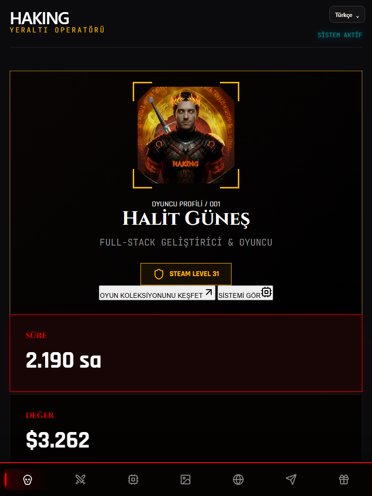
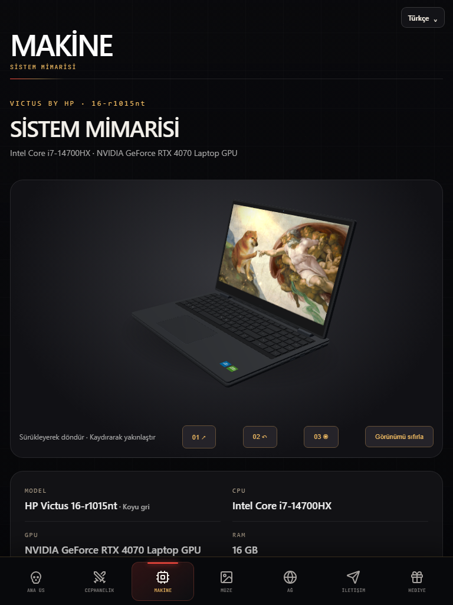
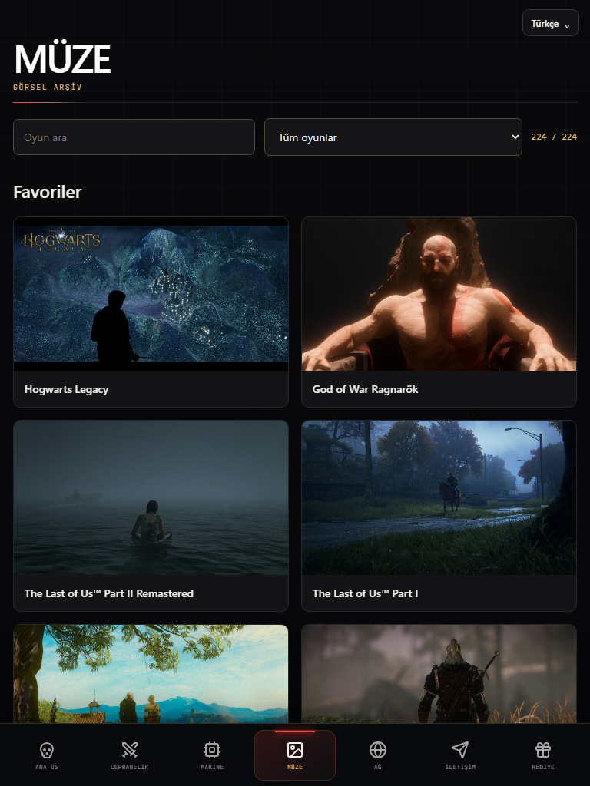
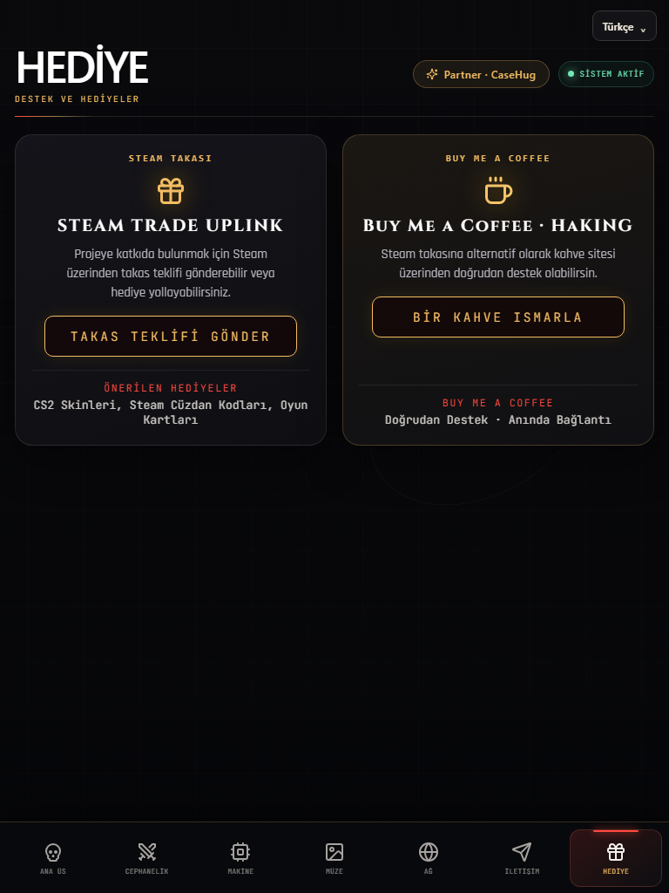

<div align="center">


# HaKING · Digital Game Vault & 3D Hardware Showcase

**Halit Güneş** için geliştirilen; canlı **Steam kütüphane telemetrisi**, etkileşimli **Three.js 3D HP Victus 16** donanım modeli, **20 dilli** (Arapça RTL dahil) çok dilli mimari ve otomatik senkronize edilen **Steam Müze arşivi** sunan statik web platformu.

[](VERSION)
[-1f2937?style=for-the-badge)](assets/js/translations.js)
[](LICENSE)
[](https://steam.haking.tr/)

[Canlı Site](https://steam.haking.tr/) · [Poster Galerisi](https://steam.haking.tr/posters/tr/) · [Değişiklik Günlüğü](CHANGELOG.md) · [Güvenlik Politikası](SECURITY.md)

</div>

---

## Önizleme

<table>
  <tr>
    <td width="50%" align="center">
      <a href="docs/home-768.png"></a>
      <br><sub><b>Ana Üs (Sanctum)</b> — Steam profil özeti, hızlı erişim ve öne çıkan oyun</sub>
    </td>
    <td width="50%" align="center">
      <a href="docs/setup-768.png"></a>
      <br><sub><b>Makine (3D Victus)</b> — Özel ekran kaplamalı Three.js HP Victus 16-r1015nt</sub>
    </td>
  </tr>
  <tr>
    <td width="50%" align="center">
      <a href="docs/museum-768.png"></a>
      <br><sub><b>Müze (Visual Archive)</b> — Favoriler, filtreleme, slayt gösterisi ve lightbox</sub>
    </td>
    <td width="50%" align="center">
      <a href="docs/support-768.png"></a>
      <br><sub><b>Destek (Support)</b> — Kaydırmasız yan yana Steam Takası ve Buy Me a Coffee</sub>
    </td>
  </tr>
</table>

---

## Öne Çıkan Özellikler (`v2.5.0`)

- **3D Sanal Müze Turu & Steam Görsel Arşivi (`#museum` & `assets/js/museum3d.js`)**
  - Klasik 2D arşiv (`Favoriler`, arama, oyun filtresi, slayt gösterisi ve lightbox) korunur; tek tıkla **"Sanal Turu Başlat"** düğmesine basıldığında isteğe bağlı **WebGL 3D Sergi Salonu** açılır.
  - Yerel Three.js `r128` eklentileri (`GLTFLoader`, `Reflector`, `RoomEnvironment`) ve Poly Haven **CC0 1.0** 3D modelleri (`marble_bust_01` klasik mermer büst, parlayan `Chandelier_02` avize) ile mermer/sıva/ceviz PBR dokuları; `224` Steam ekran görüntüsünü kanatlar (`15` eser/salon) hâlinde pirinç çerçeveler, duvar aplikleri ve yer yansımalarıyla sergiler (`WASD`, sürükle-bak, FPS kilidi, rehberli otomatik tur ve mobil dokunmatik D-Pad).

- **3D HP Victus 16-r1015nt Sahneleri (`assets/js/victus.js`)**
  - Three.js `r128` ile sıfırdan modellenmiş koyu antrasit Victus gövdesi, tam Türkçe Q/sayısal klavye dokusu, menteşe, soğutma ızgaraları ve yan portlar.
  - Bilgisayar ekranında sahibine özel `assets/images/walpaper.png` görseli yüksek çözünürlüklü sRGB doku olarak işlenir; fare/dokunmatik döndürme, klavye ok tuşları, kamera ön ayarları (`01`, `02`, `03`, sıfırlama) ve `webglcontextlost` koruması içerir.
- **Otomatik Hesap Değeri & "Ne Oynasam?" Ruleti (`#sanctum` & `#armory`)**
  - `update_stats.py`, Steam Web API (`GetOwnedGames`) verisine ek olarak Steam Mağazası toplu `appdetails` API'si (`cc=tr`, `filters=price_overview`) üzerinden kütüphanenin güncel ve liste bazlı MENA-USD hesap değerini otomatik hesaplar ve `data/steam_stats.json` dosyasına yazar.
  - `data/steam_stats.json` üzerinden otomatik senkronize edilen **270 oyun**, toplam süre telemetrisi, **oynanan/oynanmamış oranı** ve **ilk 10 oyunun süre payı**.
  - Anlık Türkçe/yerelleştirilmiş arama (`/` kısayolu), sıralama ve **oynanmamış oyunları hedefleyebilen rastgele oyun ruleti** (`#spin-game-btn`).
- **Yan Yana Destek & Profesyonel Partner Modu (`#support` & `#first-time-modal`)**
  - **Steam Trade Uplink** ve **Buy Me a Coffee** kartları `>=640px` ekranlarda tek bakışta, kaydırma gerektirmeden yan yana hizalanır.
  - Yenilenen **CaseHug × HaKING** partner penceresi; afiş (`add/SOL.png`) / WebM tanıtım sekmeleri, tek tıkla `HAK06` kod kopyalama, erişilebilir odak yönetimi, 24 saat erteleme ve Ana Üs / Destek üzerinden isteğe bağlı yeniden açma düğmeleri sunar.
- **20 Dil + Arapça RTL & SEO Poster Hattı**
  - Tek, aranabilir yerel dil seçici (`Türkçe`, `English`, `Español`, `Русский`, `Deutsch`, `Français`, `日本語`, `简体中文`, `Português`, `Italiano`, `한국어`, `العربية` RTL, `हिन्दी`, `বাংলা`, `Nederlands`, `Polski`, `Svenska`, `Tiếng Việt`, `Ελληνικά`, `ไทย`).
  - Tüm diller için üretilen statik poster galerileri (`posters/<code>/index.html`), 40 adet WebP poster (`assets/posters/`), `sitemap.xml` ve OpenGraph meta verileri.
- **Sertleştirilmiş Güvenlik ve Yerel Bağımlılıklar**
  - Sıkı `Content-Security-Policy` + `Referrer-Policy`, harici inline `<script>` / `onerror=` kalıntılarının temizlenmesi, yerel `three.min.js` (`r128`) ve `lucide.min.js` (`0.468.0`), Steam CDN URL doğrulama koruması (`https:` allowlist), harici bağlantılarda `rel="noopener noreferrer"`.

---

## Donanım Profili

| Bileşen | Özellik |
| :--- | :--- |
| **Model** | HP Victus 16-r1015nt (`9J217EA`, koyu antrasit) |
| **İşlemci** | Intel Core i7-14700HX (20 çekirdek, 28 iş parçacığı) |
| **Ekran Kartı** | NVIDIA GeForce RTX 4070 Laptop GPU (8 GB GDDR6) |
| **Bellek & Depolama** | 16 GB RAM · 1 TB SSD |
| **Ekran** | 16.1" Full HD (1920 × 1080) · 144 Hz |

---

## Depo Yapısı

```text
HaKING/
├── index.html                   # Tek sayfa uygulama iskeleti, sıkı CSP ve semantik bölümler
├── add/SOL.png                  # CaseHug × HaKING partner promosyon afişi
├── assets/
│   ├── css/{main,upgrade}.css   # Temel stil + 2.4 yan yana destek, partner modal, rulet stilleri
│   ├── images/                  # HICON.png, HaKING2.png, walpaper.png (3D ekran dokusu)
│   ├── js/
│   │   ├── lang-init.js         # İlk boyama öncesi dil ve RTL başlatıcısı
│   │   ├── translations.js      # 20 dil sözlüğü + arayüz metinleri
│   │   ├── victus.js            # Three.js HP Victus 3D sahnesi ve özel ekran dokusu
│   │   ├── main.js              # Navigasyon, Steam telemetrisi, rulet, iletişim ve partner popup
│   │   ├── museum3d.js          # Three.js WebGL 3D Sanal Müze turu ve rehberli gezi motoru
│   │   └── upgrade.js           # Müze arşivi, slayt gösterisi, dil seçici ve 3D bağlayıcı
│   ├── models/victus/           # Donanım ve kaplama referans notları
│   ├── museum/                  # CC0 1.0 Poly Haven 3D büst, avize ve PBR mermer/ahşap dokular
│   ├── posters/                 # 20 dil × 2 şablon = 40 WebP poster
│   └── vendor/                  # Yerel Three.js r128 (+ eklentiler) ve Lucide 0.468.0
├── data/
│   ├── favorites.json           # Müze vitrini için öncelikli ekran görüntüleri
│   ├── locales.json             # Poster üreteci için dışa aktarılmış dil verisi
│   ├── screenshots.json         # Sadece uzak Steam CDN URL ve başlık metadatası
│   └── steam_stats.json         # Günlük eşitlenen oyun kütüphanesi & sistem durumu
├── docs/                        # 390px / 768px doğrulama ekran görüntüleri
├── posters/                     # Statik HTML poster sayfaları (tr..th)
├── scripts/                     # Medya çözümleyici, locale aktarımı ve poster üreteci
├── tests/                       # Medya hattı, değerleme ve site bütünlüğü birim testleri
├── update_stats.py              # Steam Web API + Mağaza değerleme eşitleme betiği
├── VERSION / CHANGELOG.md       # Sürüm (2.5.0) ve sürüm notları
└── .github/workflows/           # Günlük Steam istatistik ve haftalık ekran görüntüsü akışları
```

---

## Yerel Geliştirme ve Doğrulama

```bash
# 1. Yerel HTTP sunucusu başlat (ES modülleri ve JSON fetch için gereklidir)
python -m http.server 8765

# 2. Birim ve bütünlük testlerini çalıştır
python -m unittest discover -s tests -v

# 3. Yerelleştirme verisini ve statik poster sayfalarını yeniden üret
node scripts/export_locales.mjs
python scripts/build_posters.py

# 4. İsteğe bağlı: Steam istatistiklerini ve ekran görüntüsü metadatasını güncelle
python update_stats.py
python scripts/sync_screenshots.py
```

### Otomatik GitHub Actions Akışları

- [`.github/workflows/update_steam.yml`](.github/workflows/update_steam.yml): Her 30 dakikada bir `update_stats.py` betiğini çalıştırıp `data/steam_stats.json` dosyasını (oyun listesi, süreler, çevrimiçi durumu ve TR mağaza hesap değeri) günceller (`STEAM_API_KEY` repo secret gerektirir).
- [`.github/workflows/update_screenshots.yml`](.github/workflows/update_screenshots.yml): Haftalık olarak herkese açık Steam ekran görüntüsü bağlantılarını ve poster/site haritası çıktılarını günceller.

---

## Lisans ve Telif Notları

- Proje kaynak kodu **MIT** lisansı altındadır ([LICENSE](LICENSE)).
- Üçüncü parti kütüphaneler (`Three.js r128`, `Lucide 0.468.0`, isteğe bağlı `GSAP` ve `Google Fonts`), Steam oyun görselleri/ekran görüntüleri, donanım markaları (`HP Victus`, `Intel`, `NVIDIA`) ve partner promosyon materyalleri ilgili hak sahiplerine aittir; ayrıntılar için [THIRD_PARTY_NOTICES.md](THIRD_PARTY_NOTICES.md) dosyasına bakın.
